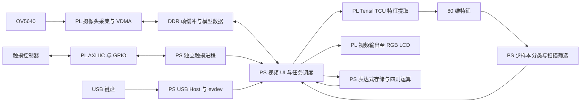

# PEFSL_MIX_PLUS 工程现状与改进总结

整理日期：2026-11-01。

本工程以原始 PEFSL 的“预训练骨干提取特征 + 少样本分类”流程为基础，完成了向正点原子领航者 ZYNQ-7020 的移植，并扩展为具备摄像头实时预览、触摸框选学习与识别、自动扫描、USB 键盘命名、数字及算符识别、四则运算的板端应用。

本文按功能模块说明改进，并在“适配工作区”中集中说明板卡移植工作。功能状态以当前源码、已有验证报告及用户实板反馈为依据；本文没有重新综合硬件，也没有新增准确率或帧率测量。

## 一、对照范围与当前有效版本

| 项目 | 对照位置或当前状态 |
|---|---|
| 原始工程基线 | `E:\FPGA-3up\PEFSL\PEFSL-main-origin`，重点对照 README、main.py、特征后端与少样本分类源码 |
| 当前主工程 | `E:\FPGA-3up\PEFSL_MIX_PLUS` |
| 早期移植基础 | `E:\FPGA-3up\PEFSL_ZDYZ_MIX` 的 fix3 工程 |
| 当前应用版本 | `mix-plus-ab-r17-20261101-r21-keyboard-calc10` |
| 当前触摸驱动版本 | `mix-plus-touch-20261024-r16` |
| 当前 A/B 算法参照 | 用户指定的 `E:\FPGA-3up\PEFSL_MIX_PLUS_digital_10.31\pynq_app` 中的 r17 |
| 当前硬件交付 | `artifacts` 中同名的 `pefsl_mix_plus_touch.bit` 与 `.hwh` |

当前版本已恢复指定旧版的 A 学习、B 手动识别和 B 自动扫描流程，同时保留后续加入的数字/算符识别、10 数字计算器和键盘功能。此前尝试的 C124 身份验证、区域候选、局部回访和结果过期策略不再参与当前 A/B 推理。目录中保留相关文件、测试和可选数据字段，主要用于历史记录及数据兼容，不能据此认定这些策略仍处于启用状态。

`plan/mix_plus_status.md`、部分 README 后半部分是早期实施记录，其中的旧轮询周期、线程方案和“下一步”不能代替当前源码状态。

## 二、原始 PEFSL 与本工程的关系

原始 PEFSL 已提供 PYNQ-Z1 上的少样本学习流程、Tensil TCU 推理支持、ResNet 骨干、NCM 等分类方法，以及模型导出和转换工具。原始主程序使用 USB 摄像头、OpenCV 界面和可选 HDMI 输出，支持按键或键盘快捷键完成采样、推理、暂停和重置。

本工程沿用了上述核心技术路线。我们完成的工作主要是目标板适配、输入输出链路重建、应用交互扩展、特征数据接口整理以及运行可靠性改进。TCU、ResNet 和 NCM 本身不是本工程新提出的算法。

这里的“在线学习”主要指采集新物体的特征、保存支持样本并更新分类统计量；当前 A/B 流程没有在板端通过反向传播重新训练 ResNet 权重。

| 功能模块 | 原始基线中的方式 | 当前工程完成的改进 |
|---|---|---|
| 板卡平台 | PYNQ-Z1 工程和配套硬件 | 适配领航者 7020 的 PS、DDR、AXI、管脚与外设 |
| 摄像头与显示 | USB 摄像头、OpenCV、可选 HDMI | OV5640 采集、VDMA、800×480 RGB LCD 实时显示 |
| 学习交互 | 按键/快捷键对当前图像采样 | 触摸指定 ROI，选择 1～4 类，采集目标局部特征 |
| 识别交互 | 原始主程序对采集画面分类 | B 模式手动 ROI 持续识别，叠加名称和分数 |
| 自动查找 | 原始主程序没有当前 SCAN 流程 | 多尺度窗口、候选筛选、重叠抑制和跨周期确认 |
| 类别命名 | 键盘主要用于控制命令，显示类别编号 | 外接 USB 键盘输入名称，框上实时预览，随类别保存 |
| 学习数据管理 | 主程序以运行时样本管理为主 | SAVE/LOAD/CLEAR，保存特征、类别、尺寸、颜色统计和名称 |
| 专项识别 | 通用少样本物体分类 | D 模式独立数字 0～9、四类算符支持库和预处理 |
| 计算应用 | 无当前计算器流程 | 将确认后的识别结果组成表达式并执行四则运算 |
| 运行可靠性 | 原始演示程序的控制循环 | 视频、输入与 TCU 分工；IIC 进程隔离、看门狗与恢复 |
| 部署验证 | 原项目的模型与演示配置 | 独立部署目录、边界验证脚本、主机回归、备份与回退记录 |

## 三、按功能模块整理改进工作

### 3.1 实时视频与 LCD 交互界面

将画面显示从原始主程序的 USB 摄像头/HDMI 路径改为领航者板上的 OV5640 和 RGB LCD，统一在 800×480 画面中显示实时图像、ROI、类别名称、识别分数和操作按钮。

应用使用一个 Overlay 管理摄像头、LCD、TCU 和触摸接口，避免各阶段重复下载 bitstream。初始化包含视频输入输出关联和预热帧处理；运行中明确 VDMA 帧的提交、归还和释放关系，修复了早期只能显示首帧、画面定格、退出不及时等问题。

当前主要交互分为 A 学习、B 识别和 D 数字/算符三个模式。触摸事件统一转换为按下、移动和松开，再由 UI 状态机处理。虽然触摸控制器已验证支持五点，当前应用按单个主要触点处理一个 ROI，没有实现多指同时编辑多个框。

### 3.2 A 模式：局部框选与少样本学习

用户先拖动框选物体，再选择类别 1～4。应用将 ROI 缩放到 32×32，默认采集 8 帧 TCU 特征，同时保留扫描所需的框尺寸及 HSV 颜色统计。相较于原始主程序直接缩放当前画面，局部框选允许用户明确指定需要学习的目标区域。

内部类别保持为 `class1`～`class4`，显示名称单独管理。给同一类别补充样本会继续使用该类别的数据；给类别改名不会自动删除旧样本，因此不能仅靠改名把已有类别替换成完全不同的物体。

学习采集、命名和模式切换之间增加了状态检查：名称和新特征在采集成功后一起提交；采集失败或过期任务不会错误覆盖已有名称。当前恢复的是指定 r17 的采样流程，没有启用历史 C124 参考图身份门。

### 3.3 B 模式：手动 ROI 持续识别

B 模式允许手动框选目标，后台定期提取该框内的新特征，并使用 A 模式已经学习的数据分类。框中物体改变后可以继续更新结果，已学习类别可重复使用，不是识别一次后就被消耗。

当前手动识别使用恢复后的 `PefslNcmClassifier.predict()`：对特征进行全局均值居中，计算类别均值并归一化，再依据距离生成类间分数。LCD 显示类别对应的名称及百分比分数。该百分比没有经过正确率校准，不能直接作为识别准确率。

手动分类和自动扫描采用不同的评分与筛选流程。`--scan-cos-th` 等扫描门限不会直接改变手动 ROI 的 NCM 分类行为；手动分类也不具备扫描流程的全部背景拒绝规则。

### 3.4 B 模式：多尺度自动扫描与背景抑制

在板端接入类似电脑端 bbox 流程的自动扫描，使用户不必为每次识别都手动画框。B 模式有已学习数据时默认启动扫描；手动画框会暂停扫描，再次点击 SCAN 可恢复自动扫描。

当前 r17 扫描流程包括：

1. 根据学习框尺寸生成多尺度窗口，轮换窗口位置，限制每周期工作量。
2. 用 TCU 提取每个窗口的 80 维特征，进行居中后的 Top1/Top5 余弦匹配，并检查类别分差。
3. 结合尺寸限制、中心与周围颜色差，以及可选的颜色直方图门限筛选候选。
4. 每类保留较优候选，抑制重叠框，并通过连续扫描周期的同类邻近确认减少瞬时误检。

当前默认参数为 24 窗/周期、窗口间隔 100 ms、余弦门限 0.56、连续 2 周期确认。中心/周围颜色差门限为 0.14，颜色直方图硬门限默认 0，即关闭。这些是当前运行参数，不是对所有场景都最优的结论。

该模块借鉴了电脑端修订程序中的候选筛选思路，并结合板端 TCU 调用成本进行分步执行。扫描仍会受背景、照明、目标大小及学习样本影响；不能将已实现背景抑制等同于已经消除所有背景误识别。当前也没有将其替换为另一个通用目标检测网络。

### 3.5 USB 键盘与类别名称输入

在原始工程已有键盘控制的基础上，新增面向物体类别的文本命名功能。A 模式完成框选后，输入字符会逐个显示在框上方；Enter 确认，再点击类别按钮完成学习。B 模式手动识别和自动扫描使用该名称替换原类别编号。

当前支持英文大小写、数字 0～9、空格和下划线，最长 24 个字符；支持 Shift、Caps Lock、Backspace、Enter 和 Esc。下划线通过 `Shift+-` 输入；小键盘数字按 Num Lock 状态处理。确认时去掉首尾空格，保留名称内部空格。

键盘输入直接读取 Linux evdev，不依赖桌面窗口焦点或串口终端输入，也不要求额外安装 Python evdev/pynput。程序根据按键能力选择真实键盘接口，避开复合无线接收器中的鼠标、多媒体和系统控制接口，并支持热插拔和独占读取。

名称与特征一起保存。没有名称的旧学习文件仍能加载并显示默认类别 ID。重新画框、切换模式、CLEAR、LOAD 或输入丢失时会取消尚未提交的命名，减少名称与错误目标关联的可能。

### 3.6 SAVE / LOAD / CLEAR 与学习数据复用

新增统一的 A/B 学习文件，默认位置为板端主工程 `pynq_app/pefsl_learned.npz`。文件保存类别、样本数量、80 维特征、扫描框尺寸、颜色统计和显示名称；名称使用字符串数组保存，加载不依赖 pickle。

| 按钮 | 当前作用 | 使用方式 |
|---|---|---|
| SAVE | 将当前内存中的 A/B 学习数据写入学习文件 | 完成一组物体学习并确认效果后保存；之后再次 SAVE 会更新该文件 |
| LOAD | 从学习文件恢复 A/B 数据和名称 | 重启程序后恢复学习结果，或在 CLEAR 后恢复上次保存的类别 |
| CLEAR | 清空内存中的 A/B 已学习类别及相关识别状态 | 需要重新学习时使用；不会直接删除已经保存的 NPZ 文件 |

CLEAR 后出现“无已学习类别”属于其预期行为；若此前执行过 SAVE，可以用 LOAD 恢复。只想在 B 模式重新识别另一个目标时，重新画框即可，不需要用 CLEAR 清除学习数据。

A/B 学习文件、D 模式数字/算符支持库和计算器表达式分开管理。SAVE/LOAD/CLEAR 不承担计算器表达式的保存和清除，计算表达式使用独立的 UNDO、RESET 和 OUT。

### 3.7 D 模式：数字与运算符识别

在通用物体 A/B 流程之外，新增 D 模式用于单个数字或算符识别。它继续使用同一 TCU 80 维骨干特征，但数字与算符各自拥有独立的支持样本、均值、分类器和预测历史，不占用 A 模式的四个物体类别。

数字支持集覆盖 0～9，当前素材共 49 张；算符支持集覆盖加、减、乘、除，四类各 5 张。支持库通过实际板端 TCU 建立特征缓存，避免直接将电脑浮点特征当作板端固定点输出使用。

图像流程增加灰度化、二值化和形态处理，将 ROI 整理为适合字形识别的输入，并提供 32×32 二值化预览。缓存记录预处理方式及相关元数据，加载时检查格式和特征维度等信息；提供建库、检查和自匹配/留一评估工具。

交互上新增 FREEZE/LIVE。FREEZE 保存当前原始画面，便于稳定框选；后台仍处理视频输入，避免单纯停止取帧造成队列积压。数字模式和 OP MODE 分别识别数字及算符。

为减少误存，当前使用分数及分差门限、历史平滑、连续有效结果稳定检查，并要求原始预测与平滑预测一致。无效字形或过期 ROI 不得沿用上一次候选。该模块当前按单个数字或单个算符工作，不是整行多位数 OCR。

### 3.8 由视觉识别结果驱动的四则运算

在 D 模式增加表达式存储和计算，将识别与实际应用连接起来。用户冻结画面、画框，待候选显示 READY 后核对，再点击 Xn 或 OPn 存入对应项；NUM/OP 类型由用户明确切换。程序只接受屏幕已经显示且仍有效的候选，并防止同一候选被重复触摸追加。

当前最多存储 10 个数字和 9 个算符，表达式形式为 `X1 OP1 X2 … OP9 X10`，每个 X 为一个 0～9 的数字。运算遵循先乘除后加减、同级从左向右；提供 UNDO 撤销最后一项、RESET 清空表达式和 OUT 输出结果。

算术在 PS 的 Python 中使用 `fractions.Fraction` 完成，保持中间计算的有理数精度。LCD 最多显示 6 位小数，舍入结果带近似标记；空表达式、表达式不完整和除零分别处理。该功能没有在 PL 中新增四则运算加速器。

LIVE/FREEZE 和 A/B/D 切换保留已经确认的表达式；重启应用后表达式清空。两种预览布局均支持表达式和结果显示。

### 3.9 并发、触摸恢复与退出可靠性

早期主循环同时承担视频、触摸和 TCU 调用，曾出现首帧定格、长按卡顿、IIC 错误后无法恢复，以及 Ctrl-C 退出延迟。工程逐步将视频/UI、TCU 工作、键盘读取和触摸访问分开处理。

当前采用单个后台 TCU 工作线程串行提交模型任务，避免扫描、学习和 D 模式同时争用同一 TCU。触摸 IIC 则放入可终止的独立进程：父进程监测心跳，超时后结束旧进程，执行触摸硬复位和 AXI IIC 复位，再创建并初始化新进程。这样可以处理旧 PYNQ 底层 C 调用阻塞、普通 Python 线程无法退出的情况。

正常触摸轮询默认 100 ms，结合 INT 门控、松手保护和事件处理；持续拖动的串口输出另行限流。恢复机制以访问状态和心跳为依据，解决了早期仅看 `touch_error=None` 不能判断触摸线程是否仍正常工作的问题。

主程序统一处理触摸和键盘事件顺序，退出时停止工作线程/进程、释放键盘和视频资源。触摸进程重建时处理继承的键盘文件描述符，避免其额外持有键盘设备。

用户已反馈 r16 阶段运行流畅，发生触摸卡顿后能够恢复，并将触控功能判定为已修复。这是已有场景下的实板反馈，后续扩展仍需保留长时间运行检查。

## 四、适配工作区：移植到正点原子领航者 7020

本节集中列出为目标板正常运行所做的适配，便于与上节的应用功能扩展区分。部分可靠性工作同时涉及驱动与应用，因此分别从硬件接口和运行行为两个角度说明。

### 4.1 板级基础与独立工程

| 适配项 | 已完成的工作 | 主要位置 |
|---|---|---|
| 目标平台 | 将 PYNQ-Z1 相关工程迁移到领航者 7020，目标器件为 `xc7z020clg400-2`，对应板级 PS、DDR 和外设配置 | `vivado_project`、板卡资料 |
| 工程隔离 | 从已经工作的 fix3 复制出 MIX_PLUS 独立 Vivado 工程、IP 仓库和 TCU 源码，保留原 fix3 | `vivado_project`、`sources` |
| 工具版本 | 使用现有 Vivado 2025.2 工程记录和输出；原始 README 的工程为 Vivado 2020.2 | `scripts`、Vivado 工程 |
| PS/PL 互联 | 沿用 fix3 已修正的 TCU 到 HP0 路径，包括位宽转换、时钟域处理和 AXI 连接，接入现有视频链路 | Block Design、TCU 驱动 |
| 时钟与复位 | 新增外设使用已有 FCLK0 与外设复位网络，保留视频和 TCU 的对应时钟域 | `base.bd`、Tcl 脚本 |
| 交付接口 | 生成匹配的 bitstream/HWH，供 PYNQ 识别 IP 名称、地址和硬件参数 | `artifacts` |

这部分工作使原有特征提取流程能在目标板上运行；不能只替换 Python 主程序而继续使用原 PYNQ-Z1 的 bitstream。

### 4.2 摄像头与 LCD 硬件/软件链路适配

领航者方案使用 OV5640 摄像头和板载 LCD 接口，替代原始主程序使用的 USB 摄像头与 HDMI 组合。PL 完成摄像头数据采集、视频流和 VDMA 通路，PS 使用正点原子镜像中的 OV5640/video2lcd 配套接口初始化并管理帧。

当前 LCD ID 为 `0x7084`，应用显示模式为 800×480、24 bpp。触摸示例工程只作为触摸协议和接口参考，没有再将其另一套 LCD 驱动并入现有视频通路，以保持显示链路一致。

软件侧增加视频输入输出关联、首帧预热、可中断等待和帧所有权处理，解决移植后“有图但不刷新”及退出问题。上述链路已经由用户确认能够实时显示移动摄像头或更换物体后的画面。

### 4.3 触摸硬件接口适配

在原 fix3 的 Block Design 中加入一个标准 AXI IIC 和两个 AXI GPIO。三个外设接入 PS GP0 的 AXI 互连 M04/M05/M06，使用 FCLK0 和 `peripheral_aresetn`。AXI IIC 中断接入已有中断拼接链路；当前应用读取独立触摸 INT 引脚进行轮询门控，没有使用 Linux 中断回调作为触摸事件来源。

| 信号 | HWH 中的 IP | FPGA 管脚 | AXI 基地址 |
|---|---|---|---|
| Touch SCL / SDA | `touch_iic` | R19 / P20 | `0x41610000` |
| Touch INT | `touch_int_gpio` | U19 | `0x41620000` |
| Touch RESET | `touch_rst_gpio` | M19 | `0x41630000` |

删除原 HDMI DDC 外部端口，释放 R19/P20 给触摸 IIC；补充对应管脚约束。当前 HWH 中 IIC 频率为 100 kHz，不能将参考 RTL 中的频率直接视为当前 AXI IIC 的配置。

### 4.4 PYNQ 触摸驱动兼容与事务修复

针对正点原子 PYNQ 2.7 镜像和实际触摸控制器，完成以下兼容：

- 兼容 AXI IIC IP 2.1 与镜像中旧版 PYNQ 驱动的版本检查，以及旧版 GPIO 的 `write(value, mask)` 接口。
- 处理 AxiIIC 使用的 cffi 缓冲区和收发返回值，封装 FT/GT 寄存器访问、控制器检测、复位、坐标与事件。
- 修正 repeated START 读事务：寄存器地址发送与接收之间保持总线，不能在这一位置等待总线空闲；接收完成后再结束事务。
- 将 FT 状态和主要坐标组织为一致的读取，避免触摸期间额外状态清零等操作破坏连续读取。
- 结合 INT、事务错误恢复、硬件 RESET、AXI IIC SOFTR 及进程重建处理总线异常。SOFTR 使用偏移 `0x40`、复位值 `0xA`。

用户实板确认的是地址 `0x38` 的 FT 控制器、版本 1，已测试四角坐标和五点同时触摸。代码包含 GT 检测分支，但没有依据将其标为本板已验证的另一种控制器。

### 4.5 TCU、模型与特征数据边界适配

沿用 PEFSL/Tensil 模型运行文件，增加面向 bbox 和当前 UI 的 `TcuFeatureExtractor` / `BackboneTensilWrapper` 接口，使摄像头 ROI 与 TCU 模型的输入输出保持明确约定。

| 边界 | 当前适配内容 |
|---|---|
| 图像输入 | 32×32、三通道、uint8 BGR |
| 浮点预处理 | 严格保留原代码的 `frame.astype(float32) / 255.0 - MEAN / STD` 运算顺序 |
| TCU 输入打包 | 展开为 `(1024, 12)`，前三路填图像通道，其他通道补零 |
| 模型输出读取 | 根据模型/驱动输出段处理 `72 + 12 = 84` 个值 |
| 分类特征 | 第一段 72 个值与第二段前 8 个值拼为 80 维；余下 4 个值单独保留诊断 |
| DMA 与驱动 | 复用 fix3 匹配的驱动和对齐修复，检查模型描述、输入输出维度及特征边界 |

这里必须按模型分段和驱动返回顺序处理，不能假定直接读取一段连续 DRAM 就等价于取得 80 维输出；也不能未经模型重新验证，将预处理表达式改成另一种常见归一化公式。

用户已经在板端运行梯度图与单像素扰动验证：两组均得到 `raw84=84`、`feature80=80`、尾部四个诊断值为零、重复输出最大差值为 0，并输出 `TCU bbox feature validation PASS`。这验证了运行及数据边界，不等于完成分类准确率或浮点模型数值等价评测。

### 4.6 Linux / PYNQ / USB Host 适配

实际环境为正点原子 PYNQ 2.7.0、Python 3.8、ARMv7、Linux `5.4.0-xilinx-v2020.2`。主程序及验证脚本使用镜像的 Python 环境运行，例如 `sudo -E /usr/local/share/pynq-venv/bin/python3`。

外接键盘初期 `lsusb` 和 `/dev/input/event*` 均为空。核查发现，原镜像已内建 ChipIdea Host、ULPI、HID 和 evdev 支持，但运行设备树的 USB0 缺少 PHY 引用和 Host 模式信息，控制器没有绑定驱动，因此仅修改键盘 Python 程序无法解决。

已完成的 USB 适配包括：

1. 确认 PS USB0 使用 MIO 28～39、复位 MIO 9；Host 路径经 USB3320 PHY 和板载 GL850G HUB。
2. 确认 P4 保持 Host 跳线 3–5、4–6，即 DN–HN、DP–HP。
3. 修复启动设备树，补充 ULPI PHY、USB0 的 `usb-phy` 引用和 `dr_mode="host"`，更新 FIT 中的 FDT 哈希，保留原内核内容。
4. 提供 SHA256 校验、安装前备份和恢复脚本，避免将不匹配的启动文件直接覆盖到其他镜像。
5. 在应用层实现 ARM 32 位 evdev 事件读取、复合接口筛选和键盘验证脚本。

用户后续启动日志已出现 USB3320、ULPI integrity check passed、ci_hdrc Host/root bus、板载 HUB 和 CX 2.4G Wireless Receiver Keyboard，说明 Host 到键盘枚举路径已经实板打通。USB UART 是独立串口控制台路径，可以继续连接电脑，不是占用 USB Host 键盘链路的原因。

此外，修复了支持库评估中 ARM 32 位 NumPy 对 `np.repeat` 计数类型的兼容问题，避免将不适用的 int64 计数直接传入。

### 4.7 部署目录、验证与回退适配

板端主应用需要 `artifacts`、`touch_deploy`、`tcu_deploy`、`pynq_app` 四部分共同部署，分别提供硬件描述、触摸驱动、TCU 驱动/模型和应用。USB Host 启动修复包另外管理，不是每次启动应用都要执行的步骤。

工程将单模块验证和整机运行分开：先验证触摸坐标，再验证 TCU 特征边界，随后接入视频/UI，最后加入扫描、数字、计算器和命名。保留各阶段日志、回归测试、备份与回退说明，便于出现问题时判断属于硬件、总线、数据边界还是应用状态。

## 五、当前 PS / PL 职责划分

PL 负责视频硬件通路、TCU 和外设接口；PS 负责图像预处理、类别/名称管理、NCM、扫描决策、交互状态和算术。当前新增的键盘、计算器及大部分识别策略属于软件扩展，不能按“新增功能数量”直接推断 FPGA 资源增加比例。

## 六、已有资源报告与验证状态

### 6.1 硬件资源：已有构建记录

以下来自 MIX_PLUS 的 `scripts/mix_plus_impl_utilization.rpt`，报告时间为 2026-10-18，是现有含触摸接口工程的实现记录，不是本次整理重新运行 Vivado 的结果，也不应当冒充原始 PEFSL 或纯 fix3 的资源数据。

| 资源 | 已用 / 总量 | 占用率 |
|---|---:|---:|
| Slice LUT | 30,240 / 53,200 | 56.84% |
| Slice Register | 34,802 / 106,400 | 32.71% |
| Block RAM Tile | 70.5 / 140 | 50.36% |
| DSP | 159 / 220 | 72.27% |
| 已占用 Slice | 12,108 / 13,300 | 91.04% |

Slice 占用率与 LUT/寄存器占用率描述的是不同指标，不能相加，也不能仅看 LUT 余量判断布局扩展空间。

同次时序报告中 WNS 为 +0.414 ns、TNS 为 0，WHS 为 +0.036 ns、THS 为 0；但同时存在 `cam_pclk` 相关 324 项无时钟引脚和 615 项未约束内部端点。因此当前记录只能说明已分析路径的结果，不能据此宣称整个设计已经完成充分约束和完整时序收敛。

### 6.2 功能与验证边界

| 模块 | 已有证据 | 当前结论 |
|---|---|---|
| 摄像头 / LCD | 用户确认移动摄像头和更换物体时画面更新 | 实时视频链路已打通 |
| 触摸坐标 | 用户确认 FT、四角和五点触摸 | 控制器与坐标路径实板通过；UI 仍按单触点操作 |
| 触摸恢复 | 用户确认 r16 卡顿后可及时恢复，判定功能修复 | 已有场景验证通过，保留恢复与健康监测 |
| TCU 特征接口 | 梯度/扰动测试 raw84、feature80 和重复输出通过 | 数据边界与确定性冒烟验证通过 |
| A/B 与扫描 | 已有多轮实板使用反馈；当前 r21 恢复指定 r17 | 当前恢复逻辑已做主机对照，恢复后的实板效果待同场景复测 |
| USB Host | 用户提供完整 Host/PHY/HUB/Keyboard 枚举日志 | 实板枚举已通过 |
| 键盘命名 | 用户确认大小写和 A/B 命名通过 | 字母命名实板通过；后加空格、数字、下划线仍需按清单验收 |
| 数字/算符/计算器 | 已有实现、支持库工具和主机回归 | 功能已接入，尚无统一场景下的准确率/时延结论 |
| 当前 r21 回归 | `ab_r17_restore_report.json` 记录 123 项主机测试通过，包含指定旧版对照 | 软件回归通过；报告明确 `hardware_accuracy_tested=false` |

123 项是已有主机报告中的结果，本次文档整理没有再次运行这批测试。主机测试使用替代摄像头/TCU，不能替代实际模型、传感器、照明和总线环境的验收。

后续如需汇报性能提升，应补充固定测试集和统一条件下的 A/B 准确率、背景误检、D 模式混淆矩阵、扫描刷新时延与长时间触摸恢复数据。目前不宜写出缺少实测依据的“准确率提升多少”或“达到多少 FPS”。

## 七、工程工作区与关键文件

下表路径均相对于当前主工程 `E:\FPGA-3up\PEFSL_MIX_PLUS`。

| 工作区 | 作用 | 关键内容 |
|---|---|---|
| `vivado_project` / `sources` | 板级硬件与源文件 | TCU、视频、Block Design、触摸参考与约束 |
| `scripts` | 硬件生成及报告 | `add_touch_interfaces.tcl`、实现资源与时序报告 |
| `artifacts` | 板端硬件交付 | 匹配的 `.bit` / `.hwh` |
| `touch_deploy` | 触摸适配 | `touch_driver.py`、`touch_iic_validate.py` |
| `tcu_deploy` | 特征后端适配 | `tcu_bbox_backend.py`、TCU 驱动、模型、验证脚本 |
| `pynq_app` | 当前应用 | 主入口、触摸 UI、扫描、数字/算符、计算器、键盘及回归测试 |
| `usb_host_fix` | 启动镜像适配 | 设备树修复包、校验、安装、备份和回退工具 |
| `plan` | 计划与部署记录 | 总计划、键盘、数字、算符、计算器及部署说明 |
| `reply` | 现场反馈 | 用户串口日志和学习数据等实验材料 |
| `backups` / `recovery` | 备份与恢复 | 历史版本及恢复材料 |
| `PEFSL_C124` 等参考目录 | 历史算法参考 | 不等同于当前运行入口或当前启用策略 |

### 主要依据与阅读入口

1. 原始 PEFSL README（历史基线，未随复现包提供）、原始 main.py（历史基线，未随复现包提供）、原始少样本分类器（历史基线，未随复现包提供）：确认继承的功能和技术路线。
2. [当前主入口](../pynq_app/pynq_bbox_demo.py)、[当前 UI 与状态机](../pynq_app/pefsl_touch_ui.py)、[扫描模块](../pynq_app/pefsl_scan.py)：确认当前有效交互、默认参数和并发方式。
3. [A/B r17 恢复说明](../pynq_app/AB_R17_RESTORE.md)、恢复验证报告（历史记录 `pynq_app/ab_r17_restore_report.json`，未随复现包提供）：确认 r21 的恢复范围与保留功能。
4. [数字预处理](../pynq_app/digit_preprocess.py)、[数字/算符识别与支持库](../pynq_app/digit_recognizer.py)、[计算器](../pynq_app/digit_calculator.py)：确认专项识别与运算边界。
5. [键盘说明](../pynq_app/KEYBOARD.md)、[键盘驱动](../pynq_app/usb_keyboard.py)、[键盘验证脚本](../pynq_app/keyboard_validate.py)：确认字符规则、设备适配和验证状态。
6. `scripts/add_touch_interfaces.tcl`（历史增量脚本未收录；完整重建请用 `scripts/rebuild_hardware.tcl`）、[触摸驱动](../touch_deploy/touch_driver.py)、[HWH](../artifacts/pefsl_mix_plus_touch.hwh)：确认引脚、地址、频率和驱动协议。
7. [TCU 特征适配器](../tcu_deploy/tcu_bbox_backend.py)、[TCU 验证脚本](../tcu_deploy/tcu_feature_validate.py)：确认输入输出与模型边界。
8. [USB Host 修复说明](../usb_host_fix/README.md)：确认设备树、校验、备份和回退方案；该说明中的早期“尚未实板验证”已由后续用户枚举日志和键盘说明补充。
9. 历史工程进度（历史记录 `plan/mix_plus_status.md`，未随复现包提供）、实现资源报告（历史记录 `scripts/mix_plus_impl_utilization.rpt`，未随复现包提供）、实现时序报告（历史记录 `scripts/mix_plus_impl_timing.rpt`，未随复现包提供）：确认工程复制、触摸接入和 2026-10-18 构建数据。

本文记录的是当前工程已有工作的归纳；当前运行行为以 r21 活动源码为准，现场效果以匹配版本的板端验证为准。
