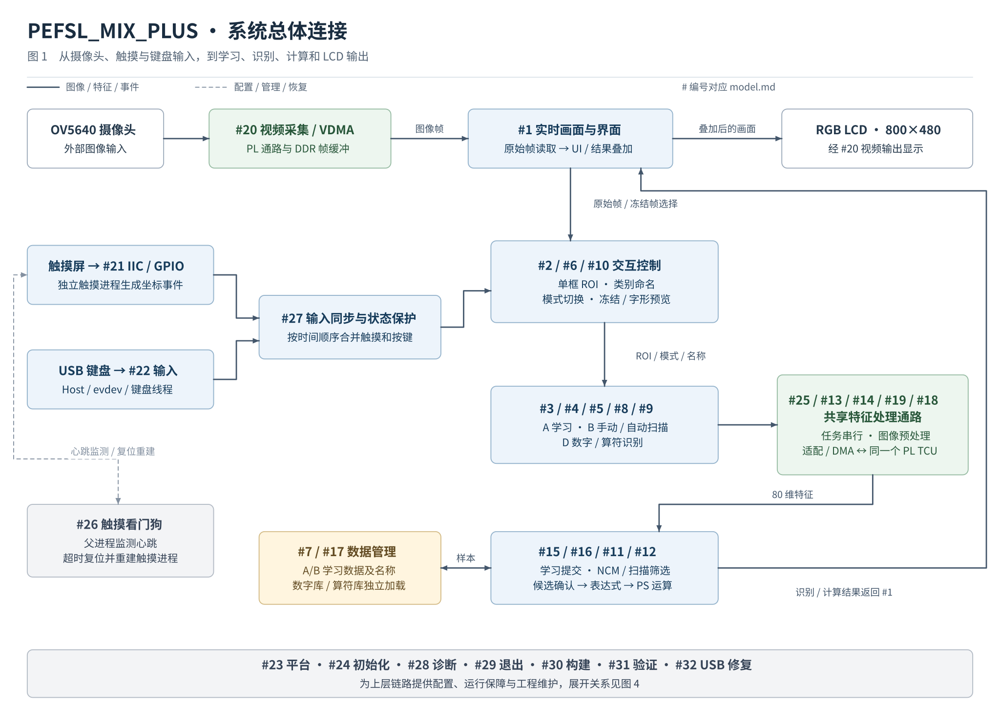
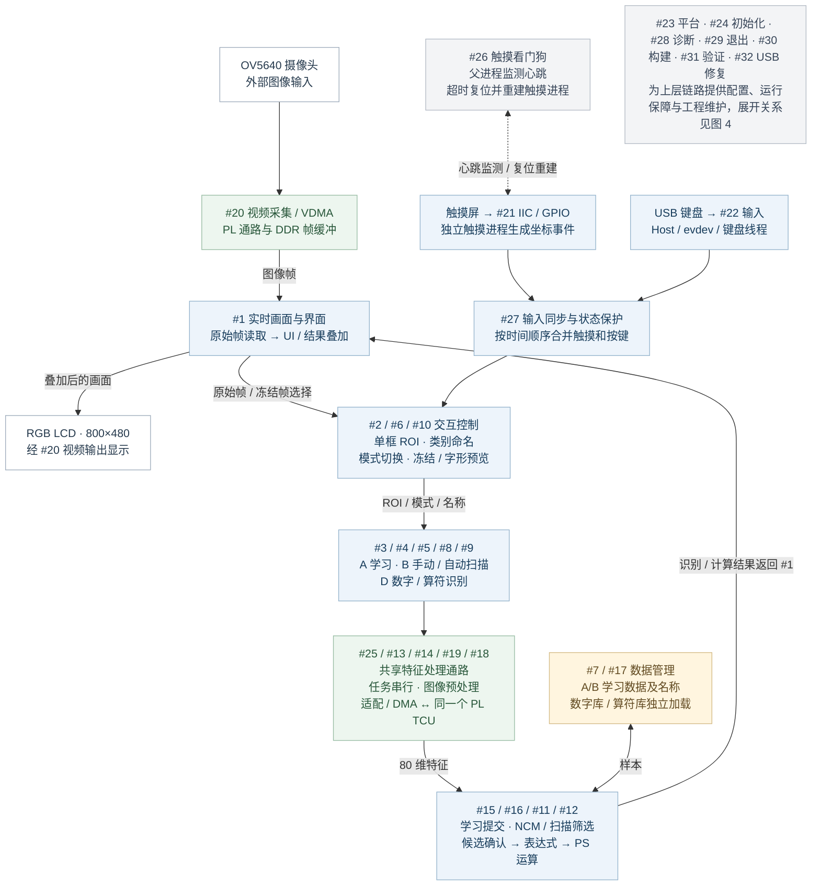
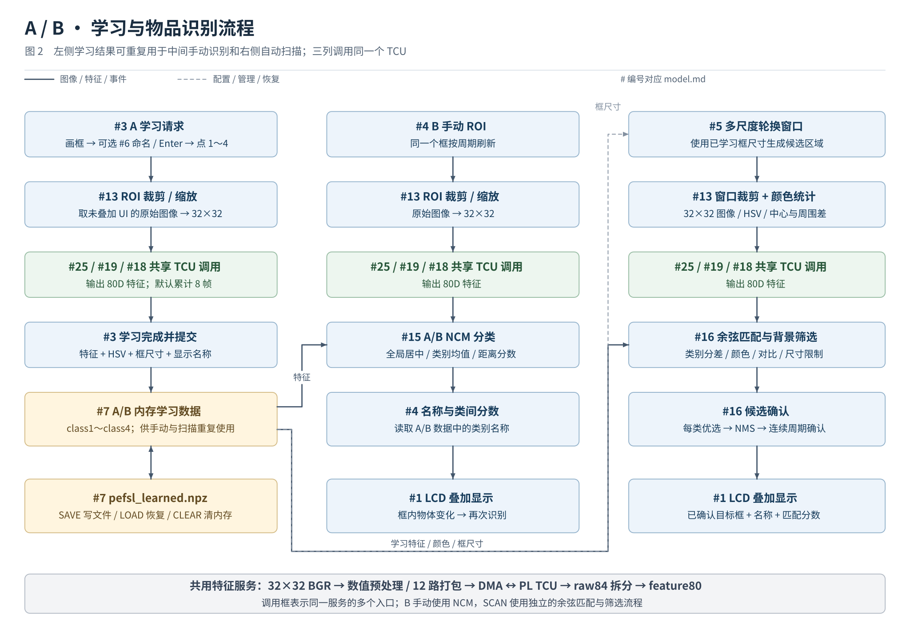
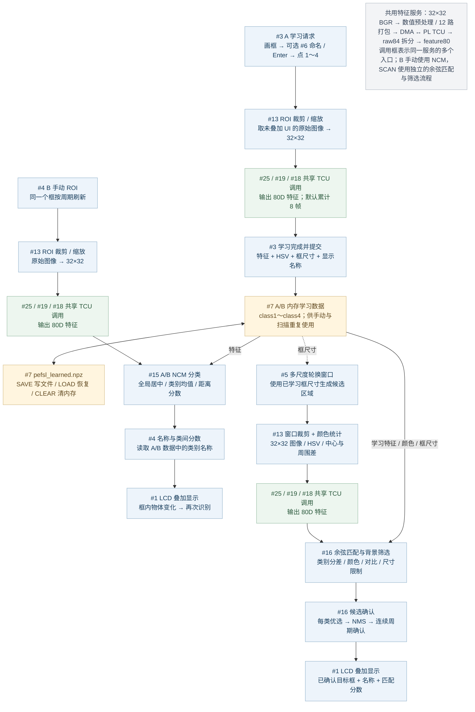
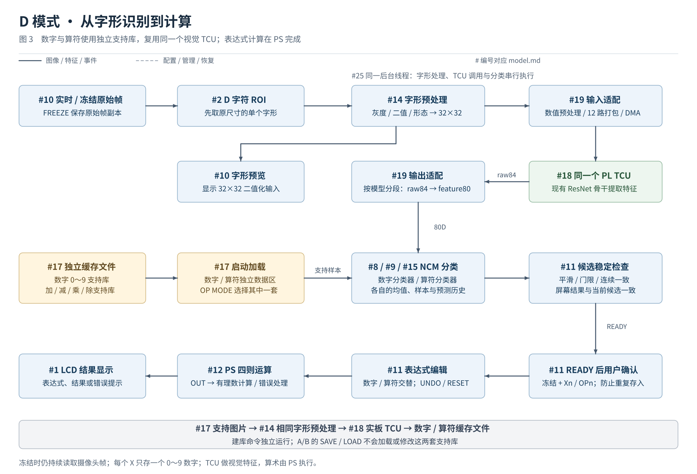
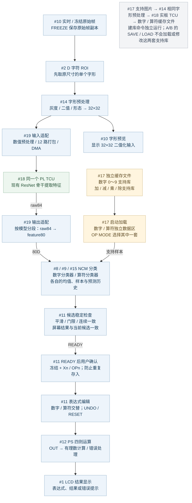
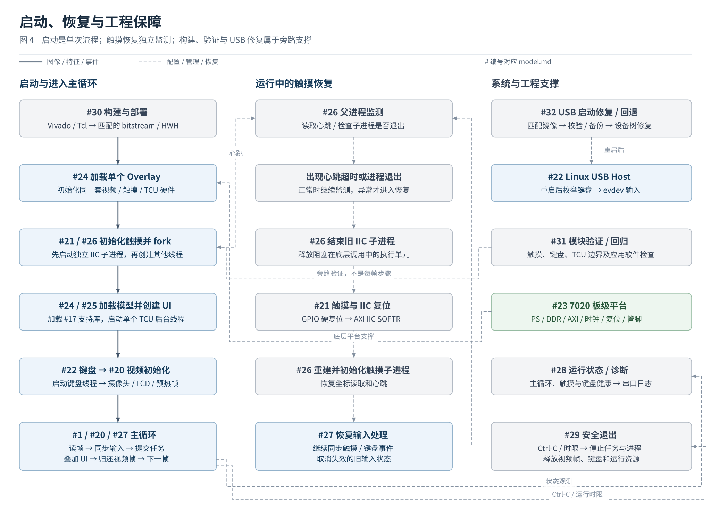
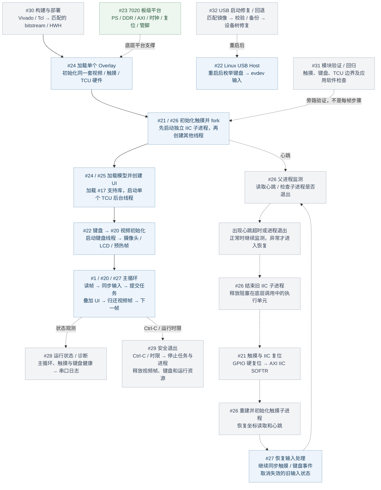

# PEFSL_MIX_PLUS 模块连接与流程图

整理日期：2026-11-02；对应当前版本：`mix-plus-ab-r17-20261101-r21-keyboard-calc10`。

依据 [model.md](model.md)、[conclusion.md](conclusion.md) 与当前活动源码绘制，覆盖模块 1～32。

节点中的编号与 model.md 一致；实线表示图像、特征或输入事件流，虚线表示配置、管理、恢复或旁路验证。图是功能连接示意，组合节点不代表每个功能都在同一个线程执行。

PS 负责交互、预处理、NCM、扫描筛选及算术；PL 负责视频硬件通路、TCU 和触摸接口。历史 C124 身份门、区域候选、局部回访和结果过期策略没有画入当前流程。

## 一、系统总体连接

摄像头提供图像，触摸和键盘提供操作事件；UI 产生学习或识别任务，统一调用 TCU，处理结果后显示到 LCD。底部支撑模块在图 4 展开。

[SVG 矢量图](flowcharts/01_system_overview.svg) · [Mermaid 源文件](flowcharts/01_system_overview.mmd)

查看可编辑的 Mermaid 连接图

## 二、A/B 学习与物品识别

A 模式建立 A/B 学习数据；B 手动使用 NCM，SCAN 使用余弦匹配与候选筛选，两条路径共享学习数据和特征提取服务。学习数据不会被一次识别消耗。

[SVG 矢量图](flowcharts/02_ab_learning_recognition.svg) · [Mermaid 源文件](flowcharts/02_ab_learning_recognition.mmd)

查看可编辑的 Mermaid 连接图

## 三、D 数字、算符与计算

D 先截取原尺寸字符 ROI，再做字形预处理；识别结果经过稳定检查并由用户确认后才写入表达式。数字和算符各自使用独立支持库，算术在 PS 执行。

[SVG 矢量图](flowcharts/03_digit_operator_calculator.svg) · [Mermaid 源文件](flowcharts/03_digit_operator_calculator.mmd)

查看可编辑的 Mermaid 连接图

## 四、启动、触摸恢复与工程保障

左列为启动顺序，中列为运行中的独立触摸恢复，右列为系统及工程支撑；右列各框不是一条依次执行的流水线。

[SVG 矢量图](flowcharts/04_startup_recovery_tools.svg) · [Mermaid 源文件](flowcharts/04_startup_recovery_tools.mmd)

查看可编辑的 Mermaid 连接图

## 五、读图时需要注意的连接关系

- **一个 TCU，多条调用路径**：A、B 手动、SCAN、D 都由同一个后台线程串行调用，图 2 的三个 TCU 调用框不是三个硬件核。
- **原始图像先用于识别，再叠加 UI**：A/B 的 ROI 先缩放到 32×32；D 则先保留原尺寸 ROI 做字形处理，随后进入同一 TCU 数值预处理和输入打包。
- **SCAN 与手动分类分开**：B 手动使用 NCM；SCAN 使用独立余弦匹配、背景筛选、NMS 和跨周期确认。
- **三套数据相互独立**：A/B 学习数据由 SAVE/LOAD/CLEAR 管理；D 数字和算符库由独立建库工具生成、启动时加载；计算式使用 UNDO/RESET/OUT。
- **键盘只先确认名称**：Enter 完成名称确认，随后点击类别 1～4 才启动采样，特征和名称在采集成功后一起提交。
- **冻结不停止视频输入**：FREEZE 保存原始帧副本供识别和显示，主循环仍持续读取并归还摄像头帧。
- **看门狗不串入正常输入链**：它由父进程独立监测心跳，异常时复位和重建触摸进程，正常触摸事件直接进入输入队列。
- **构建与 USB 修复不属于每帧处理**：Vivado 生成硬件交付，USB 修复更新匹配镜像的启动设备树，二者分别为运行初始化和 Host 枚举提供条件。

## 六、32 个模块的图中位置

| 编号 | model.md 模块 | 所在图 |
|---|---|---|
| 1 | 实时画面与 LCD 界面 | 图 1、2、3、4 |
| 2 | 触摸交互与 ROI 框选 | 图 1、3 |
| 3 | A 模式少样本学习 | 图 1、2 |
| 4 | B 模式手动持续识别 | 图 1、2 |
| 5 | B 模式自动扫描 | 图 1、2 |
| 6 | USB 键盘类别命名 | 图 1、2 |
| 7 | 学习数据管理 | 图 1、2 |
| 8 | D 模式数字识别 | 图 1、3 |
| 9 | D 模式算符识别 | 图 1、3 |
| 10 | 画面冻结与字形预览 | 图 1、3 |
| 11 | 候选确认与表达式编辑 | 图 1、3 |
| 12 | 四则运算与结果显示 | 图 1、3 |
| 13 | ROI 图像预处理 | 图 1、2 |
| 14 | 数字与算符字形预处理 | 图 1、3 |
| 15 | 少样本 NCM 分类 | 图 1、2、3 |
| 16 | 扫描候选筛选与确认 | 图 1、2 |
| 17 | 数字与算符支持库 | 图 1、3、4 |
| 18 | TCU 硬件特征提取 | 图 1、2、3 |
| 19 | TCU 数据适配与 DMA 驱动 | 图 1、2、3 |
| 20 | 摄像头采集与视频传输 | 图 1、4 |
| 21 | 触摸 IIC 与 GPIO 驱动 | 图 1、4 |
| 22 | USB Host 与键盘输入 | 图 1、4 |
| 23 | 7020 板级 PS/PL 平台 | 图 1、4 |
| 24 | Overlay 与模型初始化 | 图 1、4 |
| 25 | TCU 后台任务调度 | 图 1、2、3、4 |
| 26 | 触摸看门狗与自动恢复 | 图 1、4 |
| 27 | 输入事件同步与状态保护 | 图 1、4 |
| 28 | 运行状态与故障诊断 | 图 1、4 |
| 29 | 安全退出与资源清理 | 图 1、4 |
| 30 | 硬件构建与部署交付 | 图 1、4 |
| 31 | 模块验证与软件回归 | 图 1、4 |
| 32 | USB 启动修复与回退 | 图 1、4 |

## 七、源码对应

- [主入口与输入同步、触摸恢复](../pynq_app/pynq_bbox_demo.py)：`main()`、`_dispatch_ui_inputs()`、`TouchProcessWorker`。
- [模式状态与任务调度](../pynq_app/pefsl_touch_ui.py)：`process_frame()`、`_prediction_worker()`、`LearnedData`、`PefslNcmClassifier`。
- [扫描筛选](../pynq_app/pefsl_scan.py)：窗口生成、余弦评分、颜色统计与重叠抑制。
- [字形处理](../pynq_app/digit_preprocess.py)、[支持库](../pynq_app/digit_recognizer.py)、[计算器](../pynq_app/digit_calculator.py)。
- [TCU 数据适配](../tcu_deploy/tcu_bbox_backend.py)、[触摸驱动](../touch_deploy/touch_driver.py)、[键盘输入](../pynq_app/usb_keyboard.py)。
